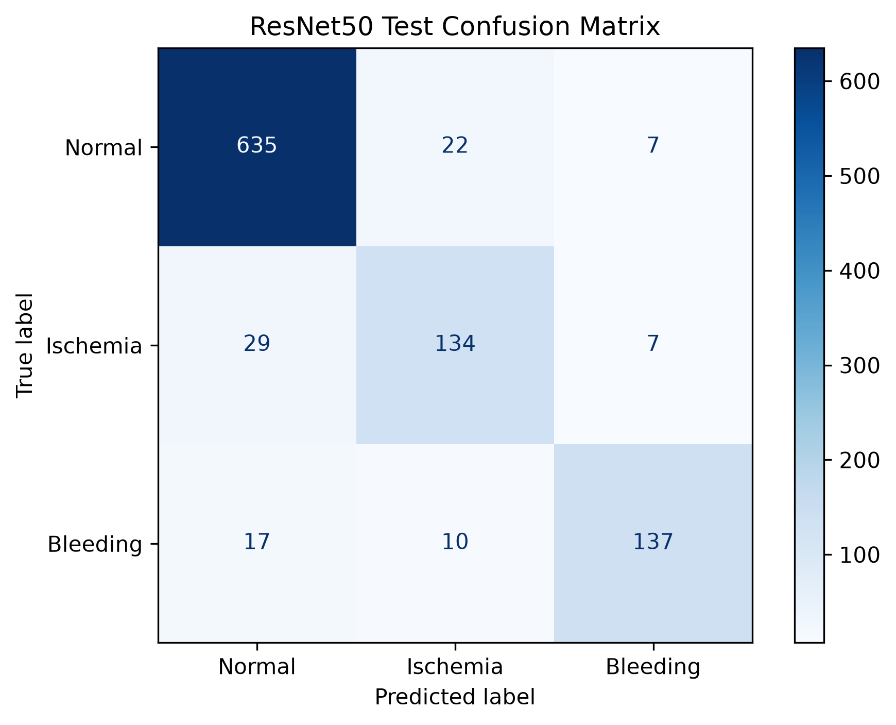

# TEKNO21 Brain Stroke Classification

**Three-class brain CT stroke classification (Normal / Ischemia / Bleeding) using transfer learning with VGG16 and ResNet50.**

📄 [Full report (PDF)](docs/Brain_CT_Stroke_Classification_Report.pdf) · 📊 [Presentation (PPTX)](docs/Brain_Stroke_Classification_Presentation.pptx) · 🗂️ [Dataset on Kaggle](https://www.kaggle.com/datasets/samali012/tekno21-brain-ct-stroke-processed-384)

---

## Overview

Stroke is time-critical, and telling ischemic stroke apart from hemorrhagic stroke is essential because the two need different treatment. This project classifies individual brain CT slices into three classes:

| Label | Class    |
|:-----:|----------|
| 0     | Normal   |
| 1     | Ischemia |
| 2     | Bleeding |

We built a preprocessing pipeline for the CT images and fine-tuned two ImageNet-pretrained CNNs (VGG16 and ResNet50). We trained each model twice, once on images with CLAHE contrast enhancement and once without, which gives **four experiments**.

**Best result:** ResNet50 without CLAHE reached **90.78% accuracy**, **86.00% balanced accuracy** and **87.06% macro F1** on the held-out test set.

> ⚠️ This is an academic experiment. It is **not** a clinically validated diagnostic tool.

---

## Dataset

We used the processed PNG release of the **TEKNO21 Brain CT Stroke** dataset:

**🔗 [TEKNO21 Brain CT Stroke – Processed 384 (Kaggle)](https://www.kaggle.com/datasets/samali012/tekno21-brain-ct-stroke-processed-384)**

The original dataset comes from the TEKNOFEST-2021 Artificial Intelligence in Healthcare Competition. It was built from anonymized brain CT scans annotated by expert radiologists ([Koc et al., 2022](https://doi.org/10.5152/eurasianjmed.2022.22096)).

| Class    | Images    | Share   |
|----------|----------:|--------:|
| Normal   | 4,428     | 66.56%  |
| Ischemia | 1,131     | 17.00%  |
| Bleeding | 1,094     | 16.44%  |
| **Total**| **6,653** | 100%    |

The dataset is clearly imbalanced, so we report balanced accuracy and macro F1 alongside accuracy.

### Splits

The train / validation / test splits are in this repository and every experiment uses the same ones:

| File              | Images |
|-------------------|-------:|
| `train_split.csv` | 4,655  |
| `val_split.csv`   | 997    |
| `test_split.csv`  | 998    |

Each CSV has three columns: `image_path` (relative to the dataset root, e.g. `Normal/13392.png`), `label_name` and `label`.

---

## Method

### 1. Preprocessing (`preprocessing_pipeline.py`)

1. **Head detection:** threshold the image (pixel > 5), then clean the binary mask with morphological closing (2 iterations) and opening (1 iteration) using a 5×5 kernel.
2. **Largest connected component:** use 8-connectivity and reject components smaller than 5% of the image area, which filters out text and markers.
3. **Crop:** crop to the head bounding box plus an 8% margin.
4. **Square padding:** pad with black so the head keeps its proportions.
5. **Resize** to **224 × 224**, using area interpolation to shrink and linear interpolation to enlarge.
6. **Optional CLAHE:** clip limit 2.0, 8×8 tile grid.

This produces two datasets: **No CLAHE** and **CLAHE**.

### 2. Models (`VGG16.py`, `Resnet50.py.py`)

- The grayscale image is copied into 3 channels to match the ImageNet backbone's input.
- The pretrained backbone is loaded with `include_top=False`.
- Both models share the same classification head: Global Average Pooling → Dense(256, ReLU) → Dropout(0.5) → Dense(3, softmax).
- **Two-stage training:**
  - **Stage 1:** the backbone is frozen and only the head is trained (LR 1e-4, up to 20 epochs).
  - **Stage 2:** the last block is fine-tuned (LR 1e-5, up to 10 epochs). For VGG16 that is `block5_`. For ResNet50 it is `conv5_`, with BatchNorm layers kept frozen.
- The stage-1 or stage-2 checkpoint with the lower validation loss is used for final testing.

| Hyperparameter     | Value                              |
|--------------------|------------------------------------|
| Input size         | 224 × 224 × 3                      |
| Batch size         | 16                                 |
| Optimizer          | Adam                               |
| Loss               | Sparse categorical cross-entropy   |
| Class imbalance    | Balanced class weights             |
| Augmentation       | Horizontal flip, rotation (±7.2°), translation (5%), zoom (±10%); training set only |
| Callbacks          | ModelCheckpoint, EarlyStopping (patience 6), ReduceLROnPlateau (×0.2, patience 3), CSVLogger |
| Seed               | 42                                 |

---

## Results

Test set: 998 images (664 Normal, 170 Ischemia, 164 Bleeding).

| Experiment              | Accuracy   | Balanced Acc. | Macro Precision | Macro F1   | Weighted F1 |
|-------------------------|-----------:|--------------:|----------------:|-----------:|------------:|
| VGG16, no CLAHE         | 87.98%     | 78.52%        | 87.31%          | 82.16%     | 87.40%      |
| VGG16, CLAHE            | 87.98%     | 78.52%        | 87.31%          | 82.16%     | 87.40%      |
| ResNet50, CLAHE         | 88.88%     | 82.92%        | 85.96%          | 84.11%     | 88.88%      |
| **ResNet50, no CLAHE**  | **90.78%** | **86.00%**    | **88.23%**      | **87.06%** | **90.70%**  |

### Per-class results for the best model (ResNet50, no CLAHE)

| Class    | Precision | Recall | F1     |
|----------|----------:|-------:|-------:|
| Normal   | 93.25%    | 95.63% | 94.42% |
| Ischemia | 80.72%    | 78.82% | 79.76% |
| Bleeding | 90.73%    | 83.54% | 86.98% |

<p align="center">
  
</p>

### Key findings

- **ResNet50 beat VGG16** with both preprocessing variants. Without CLAHE, ResNet50 improved ischemia recall by **+17.06 points** and bleeding recall by **+7.32 points**.
- **CLAHE did not help.** It made no measurable difference for VGG16 and lowered ResNet50 performance (−1.90 points accuracy, −2.95 points macro F1), mostly by causing more bleeding images to be predicted as ischemia.
- **Ischemia is the hardest class.** The most serious remaining error is a stroke predicted as normal: 29 ischemia and 17 bleeding images in the best model.
- VGG16 has high overall accuracy but much lower balanced accuracy (a gap of 9.46 points), so it leans toward the majority Normal class.

See the [full report](docs/Brain_CT_Stroke_Classification_Report.pdf) for the complete analysis, the confusion matrices of all four experiments, and the discussion.

---

## Repository structure

```
.
├── preprocessing_pipeline.py        # Head detection, crop, pad, resize, optional CLAHE
├── VGG16.py                         # VGG16 transfer-learning training + evaluation
├── Resnet50.py.py                   # ResNet50 transfer-learning training + evaluation
├── train_split.csv                  # Training split
├── val_split.csv                    # Validation split
├── test_split.csv                   # Test split
├── vgg16_results/                   # VGG16 run outputs
├── vgg16_results_contrast/          # VGG16 – CLAHE
├── resnet50_results_nocontrast/     # ResNet50 – no CLAHE (best)
├── resnet50_results_contrast/       # ResNet50 – CLAHE
└── docs/
    ├── Brain_CT_Stroke_Classification_Report.pdf
    └── Brain_Stroke_Classification_Presentation.pptx
```

Each results folder contains:
- `test_metrics.csv`
- `classification_report.txt`
- `confusion_matrix.png`
- `test_predictions.csv`
- the stage-1 and stage-2 training logs

---

## How to run

### 1. Install dependencies

```bash
pip install tensorflow opencv-python numpy pandas scikit-learn matplotlib
```

### 2. Download the dataset

Download the dataset from [Kaggle](https://www.kaggle.com/datasets/samali012/tekno21-brain-ct-stroke-processed-384) and extract it to `processed_dataset/`. It should have one subfolder per class (`Normal/`, `Ischemia/`, `Bleeding/`).

### 3. Preprocess

Set the options at the top of `preprocessing_pipeline.py`, then run it once for each variant:

| Variant  | `USE_CLAHE` | `OUTPUT_ROOT`        |
|----------|-------------|----------------------|
| CLAHE    | `True`      | `contrast_dataset`   |
| No CLAHE | `False`     | `nocontrast_dataset` |

```bash
python preprocessing_pipeline.py
```

### 4. Train and evaluate

At the top of each training script, set:
- `IMAGE_ROOT` to `nocontrast_dataset` or `contrast_dataset`
- `OUTPUT_DIRECTORY` to the folder where results should be written

Then run:

```bash
python VGG16.py
```

```bash
python Resnet50.py.py
```

Each script:
- trains both stages
- picks the best checkpoint
- writes the metrics, classification report, confusion matrix and predictions to `OUTPUT_DIRECTORY`

---

## Limitations

- **Possible patient-level leakage:** the splits have no patient IDs, so slices from the same patient could appear in more than one split.
- **8-bit PNG input:** the models use 8-bit PNGs rather than DICOM, so they have no Hounsfield units and no multi-window CT information.
- **Limited testing:**
  - one train/validation/test split
  - one seed
  - one CLAHE configuration
- **Slice-level only:** each slice is classified on its own, with no 3D context.
- **No external validation:** the models were not tested on data from other hospitals or scanners.

## Future work

- Patient-level splits
- Training on DICOM with HU windowing
- A CLAHE parameter search
- Focal loss
- Cross-validation
- Grad-CAM visualizations
- 2.5D/3D models
- Newer backbones (EfficientNet, DenseNet, ViT)
- Probability calibration
- External test sets

---

## References

1. U. Koc, E. Akcapinar Sezer, Y. A. Ozkaya, et al., "Artificial Intelligence in Healthcare Competition (TEKNOFEST-2021): Stroke Data Set," *Eurasian Journal of Medicine*, 54(3), 248–258, 2022. [doi:10.5152/eurasianjmed.2022.22096](https://doi.org/10.5152/eurasianjmed.2022.22096)
2. K. Simonyan and A. Zisserman, "Very Deep Convolutional Networks for Large-Scale Image Recognition," ICLR 2015. [arXiv:1409.1556](https://arxiv.org/abs/1409.1556)
3. K. He, X. Zhang, S. Ren, and J. Sun, "Deep Residual Learning for Image Recognition," CVPR 2016.
4. K. Zuiderveld, "Contrast Limited Adaptive Histogram Equalization," *Graphics Gems IV*, 1994.
5. D. P. Kingma and J. Ba, "Adam: A Method for Stochastic Optimization," ICLR 2015. [arXiv:1412.6980](https://arxiv.org/abs/1412.6980)
6. S. Beshir, "TEKNO21 Brain CT Stroke – Processed 384," Kaggle. [Link](https://www.kaggle.com/datasets/samali012/tekno21-brain-ct-stroke-processed-384)
